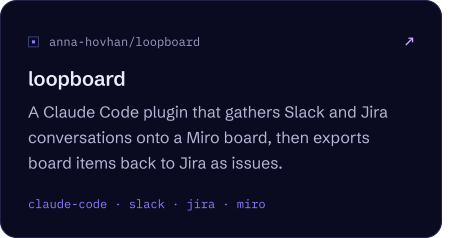
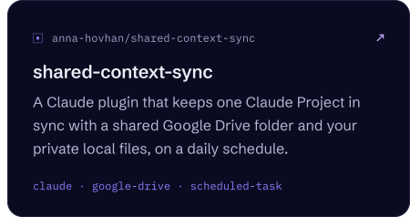

  

  
  
  

###### BUILDING

  

  

###### HOW I WORK

  

<!-- The images are drawn by scripts/build_readme.py, in the style of the design system behind annahovhannisyan.com. Edit the words there and run it again. -->
